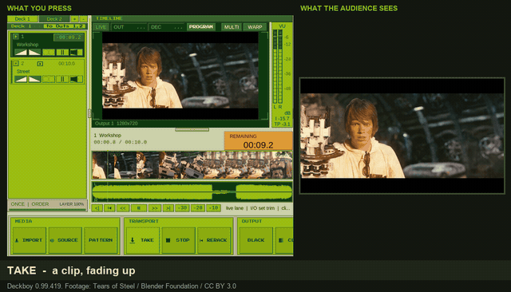

# Deckboy 🎬

<div align="center">

[](https://github.com/Utopian-Academy/Deckboy/releases/latest)
[](https://github.com/Utopian-Academy/Deckboy/releases)
[](https://github.com/Utopian-Academy/Deckboy/stargazers)
[](https://discord.gg/AZzsE4AZWx)

[](https://github.com/Utopian-Academy/Deckboy/releases/latest)
[](LICENSE)
[](https://libsdl.org)

[](https://github.com/florisporro/awesome-ndi)
[](https://github.com/RobLoach/awesome-sdl)
[](https://github.com/juancarlospaco/awesome-streaming-tools)

</div>

## Video playback and show control.

Deckboy puts videos, slides and live sources in a running order. Choose the next
cue on your desk and take it to the audience when you're ready. Send the programme
to screens, broadcast outputs or streams, and record it while it plays.

Free and open source, for Windows, macOS and Linux.

**[⬇ Download](https://github.com/Utopian-Academy/Deckboy/releases/latest)** &nbsp;·&nbsp; **[▶ See Deckboy 419 in action](https://utopian-academy.github.io/Deckboy/trailer.html)** &nbsp;·&nbsp; **[♡ Community & help](https://utopian-academy.github.io/Deckboy/community.html)**



<sub>What you press, and what the audience sees, from one run of v0.99.419. [Watch Deckboy with music by YMCK](https://utopian-academy.github.io/Deckboy/trailer.html). Footage: [Tears of Steel](https://mango.blender.org/), Blender Foundation, [CC BY 3.0](https://creativecommons.org/licenses/by/3.0/).</sub>

**If Deckboy is useful to you, ⭐ star this repository** (top right): it is how the next
operator finds it, and how you find it again.

### New in 0.99.421

[Release notes and downloads](https://github.com/Utopian-Academy/Deckboy/releases/tag/v0.99.421)

- **Every display in reach.** Connected Displays now opens Video Outputs > Screen, with room
  for three, so a projector you plug in is there without scrolling.
- **The tour on one screen.** With a single display, the guided tour's output step hands the
  desk back with a key or a click, and the tour carries on.

### New in 0.99.420

[Release notes and downloads](https://github.com/Utopian-Academy/Deckboy/releases/tag/v0.99.420)

- **Sequences on one button.** A DASH tile can run several commands in order, with
  waits between them: `SEQ DECK 1 TAKE 1 ; WAIT 2.5 ; DECK 3 TAKE 1`.
  The tile shows which step it is on, and Companion runs it the same way.
- **TAKE ALL.** With more than one playlist, one press takes the selected cue on every
  playlist at once.
- **Example shows that build up.** Five shows, from a picture on a screen to a
  one-button show, with real footage.
- **A notch at 100%.** The master fader settles on exactly 100% as you drag past it.
- **haze**, a new theme, slow and green, with smoke curls and drifting wax.


<sub>A real crossfade in v0.99.419: the outgoing clip keeps playing until it has faded. Footage: [Tears of Steel](https://mango.blender.org/), Blender Foundation, [CC BY 3.0](https://creativecommons.org/licenses/by/3.0/).</sub>

#### Also in recent releases

- **Learn the basics:** a five-minute guided tour from the startup screen or MENU, in a
  practice show that leaves yours alone.
- **Crossfades that keep moving:** the clip on screen keeps playing while it fades out.
- **Moiré**, scopes that keep up, and a warp monitor that shows the output being warped.

- **Master tracker:** a pattern view with keyboard editing, cue, fade, volume and opacity
  cells, column mute/solo, jumps and named sections. The classic grid is still there.
- **HDR:** graphics over PQ or HLG feeds, HDR window output, ST 2110, SRT/enhanced RTMP
  and recording.
- **Phone control:** pair with a QR code; TAKE, transport, fader, cue list, DASH and
  tracker on one page.
- **Lights and live audio:** named fixtures over Art-Net or sACN, Mic cues with fades and
  processing, and live captions made on your machine.
- **Projection:** edge blending, test cards and saved defaults for new shows.


### A closer look

<table>
<tr>
<td width="50%"><b>Picture scopes</b><br><br>Waveform, vectorscope, parade and gamut measurements from the moving test card.</td>
<td width="50%"><b>Lights by name</b><br><br>Fixture levels and colours in the cue list.</td>
</tr>
<tr>
<td width="50%"><b>Live input, cued</b><br><br>A Mic cue's gain and meter, shown with the built-in test signal.</td>
<td width="50%"><b>The phone controller</b><br><a href="https://utopian-academy.github.io/Deckboy/#phone-demo"></a><br><a href="https://utopian-academy.github.io/Deckboy/#phone-demo">Watch it select and take cues.</a></td>
</tr>
</table>

<details>
<summary><b>The current desk in three themes</b></summary>

**Gameboy**


**Dark**


**Virtual Boy**


</details>

[All screenshots, GIFs and clips](https://utopian-academy.github.io/Deckboy/press.html#images)
are real app captures. Desk, crossfades, effects and scopes: published v0.99.419.
Other captures retain their original versions in the [media notes](docs/images/readme/README.md).

New to Deckboy? Choose **EXAMPLE SHOWS** on the startup screen, read the notes on each
cue and make the show your own.

### Everything is a cue

A clip. A still. A slide. A live camera. A window on the machine. A web page.
An NDI source, an SRT feed, an SDI input. A test card, a countdown, a lower
third, an audio file, a line-up tone. A line of code you type while it is on
the screen. In Deckboy every one of those is the same kind of object, sitting
on the same cue list, and it behaves the same way: same transport, same fades,
same seventeen transitions, same effect rack, same remote control, recorded the
same way on the way out.

So a show can run

```
VIDEO → SLIDE → LIVE CAMERA → WEB PAGE → SRT FEED → TEST CARD → VIDEO
```

with one operator, one spacebar and no alt-tab, because none of those is a
special case. The usual way to do that is a media player, a slide program, a
browser, a capture utility, a streaming tool and a pattern generator, each with
its own idea of what happens when you press play — and a projector that shows
the seams between them.

The other half of the same idea: every **destination** is the same kind of
object too. A screen, NDI, SRT, RTMP, Blackmagic SDI, SMPTE ST 2110 — several
at once, while it records, each with its own warp, feather and area of
interest. Driven from a Stream Deck, Bitfocus Companion, OSC, MIDI, MIDI Show Control
from the lighting desk, Art-Net or LTC timecode.

Anything that can make a picture or a sound becomes a cue. Anything that needs
to receive the show becomes an output.

It hosts **your own VST3 effects and instruments** in a cue's audio chain, and runs on a
machine with **no sound card at all** — a rack PC feeding a video wall still
opens, plays and puts a picture out.

Windows, macOS and Linux from one show file. No account, no licence server, no
telemetry, and no second licence for the spare machine in the flight case —
which is not true of most of what it gets compared to.

**[deckboy website](https://utopian-academy.github.io/Deckboy/)** — what it does, and where to download it. · **[How it compares](https://utopian-academy.github.io/Deckboy/compare.html)** to Mitti, PlaybackPro, QLab, Millumin, vMix, SimplePlay, PlayDeck, ProVideoPlayer, Resolume and Inkue. · **[Manual](https://utopian-academy.github.io/Deckboy/manual.html)** — all of it, thirty chapters. · **[FAQ](https://utopian-academy.github.io/Deckboy/faq.html)** · **[Where latency hides](https://utopian-academy.github.io/Deckboy/latency.html)** — the four stages of a live chain, in frames and milliseconds

---

## Community & help

Questions, bugs, production stories, or ideas? [Visit the community page](https://utopian-academy.github.io/Deckboy/community.html) or [read the support guide](SUPPORT.md), join [GitHub Discussions](https://github.com/Utopian-Academy/Deckboy/discussions), or [contribute](CONTRIBUTING.md). For security issues, please use [private reporting](SECURITY.md), not public issues.

Deckboy is free software. If it helps you run a show, share your experience, report a bug, improve the docs, or tell another operator about it. That's how the project grows.

---

## Download

**[Try the example shows](data/demos/starter-pack/README.md)** — five shows that
work up one step at a time: a picture on a screen, a running order, layers and
titles, looks and effects, and a 39-second show run from one button with original
music. Open the `.deckboy` files and follow the cue notes.

The features below describe the current source. Packaged builds and their
version-specific changes are listed on the [releases page](https://github.com/Utopian-Academy/Deckboy/releases).

Every release ships an installer **and** a portable build for each platform.
Both bundle the application, FFmpeg and its runtime libraries for ordinary file
playback. NDI uses the separately installed NDI runtime; SDI uses compatible
Blackmagic hardware and Desktop Video. Office slide conversion uses PowerPoint,
Keynote or LibreOffice on the machine. [Full requirements](https://utopian-academy.github.io/Deckboy/specs.html#system).

| Platform | Installer | Portable |
|---|---|---|
| **Windows** | `…-windows-x64-setup.exe` — Start Menu, uninstaller, `.deckboy` file association | `…-windows-x64.zip` |
| **macOS** (Apple Silicon) | `…-macos-arm64.dmg` — drag to Applications | `…-macos-arm64.zip` |
| **macOS** (Intel) | `…-macos-x86_64.dmg` | `…-macos-x86_64.zip` |
| **Linux** | `…-x86_64.AppImage` — one file, `chmod +x` and run; or `…-x86_64.flatpak` | `…-linux-x86_64.tar.gz` |

**Deckboy Mini** comes inside all of those, and on its own as a small download
of about 12 to 18 MB: `Deckboy-Mini-…-windows-x64.zip`, `…-macos-arm64.zip`,
`…-macos-x86_64.zip`, `…-linux-x86_64.tar.gz`, and `…-linux-arm64.tar.gz` for a
Raspberry Pi (64-bit) or any ARM64 Linux.

Both control surfaces ship with every release, so neither needs a build:
**Stream Deck** (`…streamDeckPlugin` — double-click it) and **Bitfocus
Companion** (`Deckboy-companion-module-….zip` — unzip it, then point
Companion's *developer modules path* at the folder containing it;
`INSTALL.txt` inside has the three steps). The Companion module requires
**Companion 5**.

→ **[Latest release](https://github.com/Utopian-Academy/Deckboy/releases/latest)**

Or from a package manager, which follows each new release:

```powershell
# Windows (Scoop)
scoop bucket add deckboy https://github.com/Utopian-Academy/scoop-deckboy
scoop install deckboy/deckboy
```

```sh
# macOS (Homebrew)
brew install --cask utopian-academy/deckboy/deckboy
```

<details>
<summary><b>"Unknown developer" warnings — what to do</b></summary>

Deckboy's Windows builds are unsigned and macOS builds are ad-hoc signed.
Neither carries a verified publisher signature, so the OS may warn when you
first open a download.

- **macOS** — if it says the app is damaged, clear the quarantine flag once:

      xattr -dr com.apple.quarantine /Applications/Deckboy.app

  Install from the `.dmg` into Applications rather than running from Downloads;
  that is also what avoids Gatekeeper's App Translocation sandbox.
- **Windows** — SmartScreen may say "Windows protected your PC". Click
  **More info → Run anyway**.
- **Linux** — the AppImage runs on **Ubuntu 22.04 and anything newer**, which
  is what a lot of venue machines are still on. Graphics, display server, audio
  and the C/C++ runtime deliberately come from the host: they have to match the
  machine actually running, and a bundled libGL cannot load your GPU driver.
  The build checks that floor on every run rather than trusting it.

</details>

Deckboy checks interface labels at startup and automatically tries another
rendering path when needed. The [FAQ](https://utopian-academy.github.io/Deckboy/faq.html#interface-text)
explains the renderer log and how to select software rendering on a Mac.

---

## What it is

Deckboy is a native desktop application for video engineers, AV technicians and
live operators who need a reliable way to organise media, trigger cues, loop
content and send video to production displays.

That is the job it is built around, and it is built on a stubborn principle:
**Seize the means of playback ♡**

No subscription ♡ No account ♡ No telemetry ♡ Nothing phones home. And no licence
server that can refuse to start the show at 19:55 because it could not reach the
internet. The machine you carried into the venue is the machine that plays the
show.

### What can be a cue

| | |
|---|---|
| **Video** &middot; **Image** &middot; **Audio** | files, hardware-decoded, trimmed and faded |
| **Slides** | a PDF, PowerPoint or Keynote deck, one cue per slide, with the notes |
| **Browser** | a URL rendered into the programme, not a browser window on your desktop |
| **Window** &middot; **Screen** &middot; **Camera** | captured live, at the window's own full resolution |
| **NDI** &middot; **SRT / RTMP / RTSP / UDP** &middot; **DeckLink** &middot; **Spout** | somebody else's signal, taken in as a cue |
| **Pattern** &middot; **Test card** &middot; **Tone** | generated on the spot, no file needed |
| **Timer** &middot; **Lower third** | a stage countdown, full screen or over the programme, and a name strap in 52 looks |
| **Video synth** &middot; **Code** | an oscillator with feedback, or an expression you type live |

Every row takes the same fades, the same transitions, the same effect rack, the
same trigger from a Stream Deck, and is recorded the same way on the way out.
[Chapter 5 of the manual](https://utopian-academy.github.io/Deckboy/manual.html#cue-types)
is the full table, source by source.

### Which makes it a very good video Swiss army knife

That is not a second feature list. It is what falls out of the first one. If a
camera is a cue and SDI is an output, the machine is a converter. If a stream
is a cue and NDI is an output, it is a bridge. If a test card is a cue, it is a
pattern generator that proves the real chain instead of a test box's.

The same box speaks NDI, SDI, SMPTE ST 2110, SRT, RTMP, Spout, LTC timecode,
OSC, Art-Net and NMOS — so the machine you brought for playout usually solves
the other five problems on the day as well.

- **Convert media** that will not play well, in place, without leaving the app
- **Inspect any file** — codec, raster, frame rate, channels, duration — by importing it
- **Generate test patterns** and a test card to prove a chain end to end
- **Capture** a camera, a window or a screen and treat it as a cue
- **Bridge formats** — bring a camera, capture card or stream in and send the
  programme out as SDI, ST 2110 or a stream, and record it
- **Normalize loudness** to a chosen −16, −23 or −24 LUFS target before playout
- **Generate LTC timecode** on its own routable output

### Where it gets used

Live events • Corporate presentations • Churches • Schools & universities •
Museums & installations • Digital signage • Projection • LED walls • Streaming

And the jobs in between: bench-testing a screen before anyone arrives, proving a
cable or converter with a real test card, getting a camera or a stream onto
SDI, restreaming to SRT or RTMP, or making a client's unplayable file
playable on site, minutes before doors.

### Deckboy Mini

**For a screen nobody has to run:** a foyer loop, a backstage monitor, a kiosk that
starts with the computer. `deckboy-mini` ships beside Deckboy: point
it at clips or a folder and it plays them fullscreen through the same engine as
the desk, in name order, holding stills, looping if you ask. It answers the
desk's remote commands on the desk's port, so Companion drives it as deck 1,
and the whole show runs from the keyboard in its terminal, over SSH too:
reorder, rename and remove cues, save and open playlists (M3U8), pick the
display and the sound device, and the keys a media player has — frame step,
speed, A-B loop, mute, sound track and subtitles. It keeps a media player's
running-order habits too: find a cue by name, queue the one to play next, stop
after this cue, shuffle, a clock that counts down, and a crossfade between
cues. It opens `.pls` lists as well as M3U8. On a Raspberry Pi it plays
through the board's own video decoder; `tools/linux_build.sh --mini` builds it
there. Its own [miniature manual](https://utopian-academy.github.io/Deckboy/manual.html#deckboy-mini)
has every key and command. Mini comes inside every download, and on its own as
a small download for Windows, macOS, Linux and the Raspberry Pi (64-bit) on the
[releases page](https://github.com/Utopian-Academy/Deckboy/releases/latest).

```
deckboy-mini ~/Videos --display 2 --loop
```

In Windows PowerShell, start it as `.\deckboy-mini` from its folder; PowerShell does not
run a program from the current folder by its bare name. Or drop files onto `deckboy-mini.exe`.


---

## Features

The full list is long, because so much can be a cue. It lives on its own page: **[all features](FEATURES.md)**, in nine groups:

- Playback & cues
- Sources — everything that can be a cue
- Outputs — everywhere a cue can go
- Presenting from slides
- Broadcast / IP video
- Audio
- Show control
- Effects & mixing
- Interface

## Built for operators, not data harvesters

Deckboy collects nothing and sends nothing to its developers. **No telemetry,
no usage reporting, no crash upload, no account.** Crash logs are written to a
file next to the app for you to read or forward, and they stay there.

There is an update check, and it is **off by default**. Switched on, it asks
GitHub's releases API whether a newer version exists — nothing about you goes
with the question, and finding one never installs anything without you saying
so. A machine sitting on a venue's network should do nothing nobody asked it
to.

It is deliberately network-active — NDI discovery, PTP, NMOS registration, OSC,
Companion control and streaming all talk to the network by design. Every one of
those goes to your own LAN or to a destination you configured.

---

## Platforms

One show file opens on Windows, macOS and Linux, and nearly everything above
runs on all three. The exception: texture sharing with Resolume, TouchDesigner
or OBS is Spout, on Windows only.

Hardware decode is used wherever the platform provides it — D3D11VA, Video
Toolbox, VAAPI — and on Windows and macOS the picture never touches system
memory on the way to the screen: roughly ten times less CPU for 4K, which is
CPU your machine gets to spend on everything else.

---

## Documentation

- [Code map](docs/CODEMAP.md) — file inventory, data flow, threading model
- [Packaging guide](docs/PACKAGING.md)
- [Changelog](CHANGES.md)
- [ST 2110 feasibility](docs/ST2110_FEASIBILITY.md)

The changelog is the authoritative record of what landed and, just as
importantly, what each feature deliberately does not do.

---

## Friends of Deckboy

- [AV Tools Pro](https://avtoolspro.com/) — free AV design calculators:
  projector throw and brightness, AVoIP and Dante/AES67 bandwidth, video wall
  and LED pixel pitch, cable, rack and PoE planning

---

## Roadmap

**Audio, next:**

- Multichannel audio files, up to 24 channels each, every channel routable
- Effects on a device's outputs as well as on each cue
- Fades that ramp effect settings and playback speed, not only level
- Object audio: place a cue in your speaker layout and move it across the room
- Named outputs and an output patch editor

**Show control:**

- Cue carts, and templates for new shows
- Defaults that say what they do: forgetting your saved defaults (which only
  changes what NEW starts from) told apart plainly from the show that is open
- A routing map: tap a deck's "to Out 1" tag to see where every deck, layer
  and output goes
- A lighting dashboard, beyond the fixture patch
- MIDI and OSC monitors: every message arriving, as it arrives, with what
  Deckboy did with it, so a controller that "does nothing" can be seen
- Live scoreboard data as a source: the clock, scores and fouls read off a
  venue's scoreboard by [OSO (Open Scoreboard OCR)](https://github.com/openscoreboardocr/OSO-Open-Scoreboard-OCR)
  and its XML/JSON feed, driving text and lower thirds on the outputs

**The face:**

- A face you can make your own: how it looks, what it does and what it talks
  about, including lines you write yourself. Every setting starts from the face
  as it is today, and none of them can touch playback, routing or outputs

**Picture:**

- Lip sync held within a few milliseconds across a whole day of playback, on
  every platform
- HDR the rest of the way: HDR over SDI shown on a real DeckLink card (it is
  built, not yet tested on one), HDR in over SDI, HDR over NDI (which needs
  NDI's separately licensed Advanced SDK), and HDR input on macOS and Linux
- Local AI upscaling: an upscale job that turns a clip into a sharper, bigger
  file, and real-time upscaling on the GPU where the hardware offers it
- Drawing on the picture: a pen that draws over the output live, the way a
  sports telestrator does, and paint cues drawn ahead of time that take, fade
  and layer like any other cue

**Scopes:**

- False colour on the picture scopes
- Sound scopes: loudness to EBU R 128, true peak, phase and spectrum
- Scopes on the desk, on any output and over NDI

**Deckboy Mini:**

- A media browser in the terminal: browse folders, filter by typing and add clips
  without leaving the keyboard, shared with the desk's own browser

**Web Monitor and network:**

- A Web Monitor at full resolution and the right shape, that pauses, rewinds
  and returns to live without losing the picture
- Encrypted connections (HTTPS) for the Web Monitor and the phone remote

**Platform:**

- Hardware-paced ST 2110 output for narrow-model compliance
- Syphon *input* on macOS as a cue source (Spout already works both ways on Windows)

---

## License

Deckboy is free software under the **GNU General Public License v3.0 or later**.
Copyright © 2026 Deckboy Contributors. The full text is in [LICENSE](LICENSE).

Bundled components keep their own licences — ffmpeg ships with its LGPL/GPL
notice beside the binary, and the NDI and DeckLink SDKs are loaded at runtime
rather than distributed.

NDI® is a registered trademark of Vizrt NDI AB.

---

## Contributing

Deckboy is built in the open and contributions are welcome — code, bug reports,
documentation, testing, or production feedback from a real show.

The best open-source tools are built by the communities that use them.

---

## Project status

Actively developed, on all three platforms. Windows, macOS and Linux build from
the same source and every commit is checked by CI in both full and
reduced-feature configurations — macOS as a self-contained app bundle, Linux as
a portable tarball and an AppImage.
