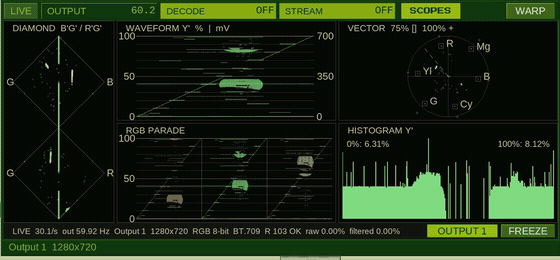
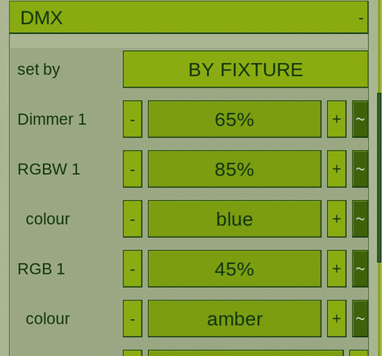
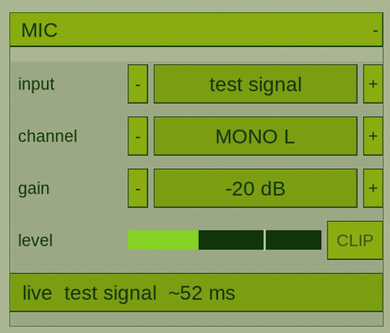
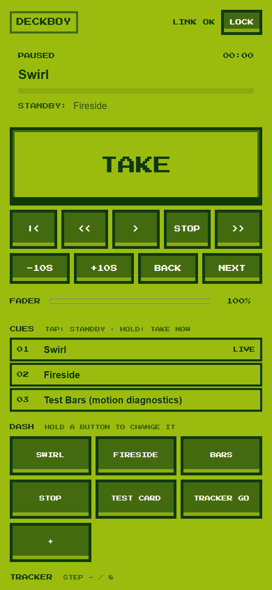
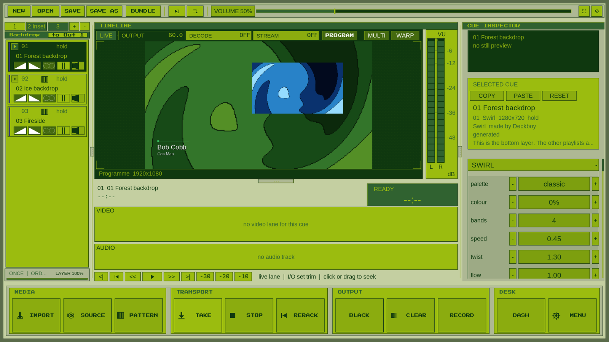
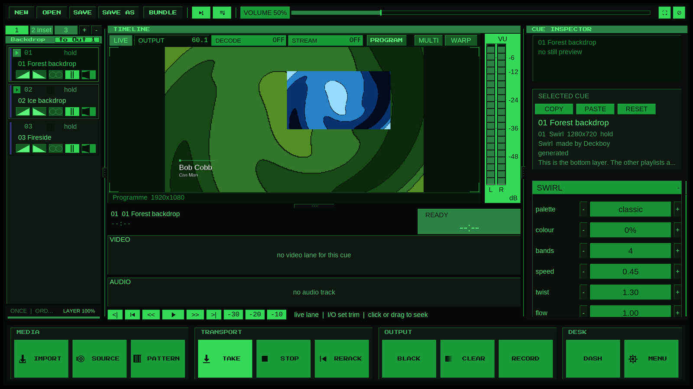
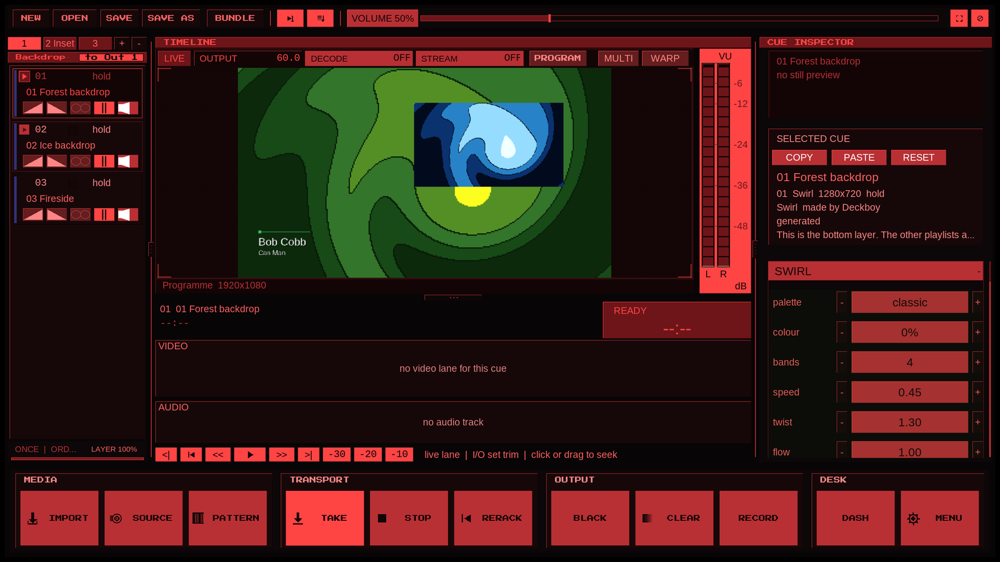

# Deckboy 🎬

<div align="center">

[](https://github.com/Utopian-Academy/Deckboy/releases/latest)
[](https://github.com/Utopian-Academy/Deckboy/releases)
[](https://github.com/Utopian-Academy/Deckboy/stargazers)
[](https://discord.gg/AZzsE4AZWx)

[](https://github.com/Utopian-Academy/Deckboy/releases/latest)
[](LICENSE)
[](https://libsdl.org)

[](https://github.com/florisporro/awesome-ndi)
[](https://github.com/RobLoach/awesome-sdl)
[](https://github.com/juancarlospaco/awesome-streaming-tools)

</div>

## Video playback and show control

Deckboy plays videos, slides and live sources in a running order. You select
the next cue on the desk, and you take it to the audience when you are ready.
Deckboy sends the programme to screens, broadcast outputs and streams. It can
record the programme while it plays.

Deckboy is free and open source. It runs on Windows, macOS and Linux.

**[⬇ Download](https://github.com/Utopian-Academy/Deckboy/releases/latest)** &nbsp;·&nbsp; **[▶ See Deckboy in action](https://utopian-academy.github.io/Deckboy/trailer.html)** &nbsp;·&nbsp; **[♡ Community & help](https://utopian-academy.github.io/Deckboy/community.html)**


<sub>What you press, and what the audience sees, from one run of v0.99.423. [Watch Deckboy with music by YMCK](https://utopian-academy.github.io/Deckboy/trailer.html). Footage: [Tears of Steel](https://mango.blender.org/), Blender Foundation, [CC BY 3.0](https://creativecommons.org/licenses/by/3.0/).</sub>

**If Deckboy is useful to you, ⭐ star this repository** (top right). Stars help
other operators find it.

### New in 0.99.424

[Release notes and downloads](https://github.com/Utopian-Academy/Deckboy/releases/tag/v0.99.424)

- **Smooth playback at all frame rates.** Each clip plays with the most even
  frame pattern that its frame rate allows on its screen. For example, 24 fps
  on a 60 Hz screen plays as a clean 3:2 pattern, and 50 fps plays as
  1-1-1-1-2. In a playlist with mixed frame rates, Deckboy sets the pattern
  for each clip.
- **Lock to the screen.** Some clips are near the screen's rate but not equal
  to it (59.94 fps on 60 Hz, or 23.976 fps on 24 Hz). Deckboy can play these
  clips at the screen's rate, so each frame shows exactly once. The sound
  changes speed to stay in sync, like a tape machine.
- **Fewer dropped frames.** A clip no longer freezes for 0.1 seconds each time
  it loops. On a Mac, each output now stays in time with its screen: in a
  one-minute test at 60 fps on an M4 MacBook Air, no refreshes were missed. On
  Windows, the desk no longer delays the outputs while it draws. Renderers
  other than Direct3D 11 do less work for each frame.
- **Seamless loops.** A looping clip has no held frame and no gap in the sound.
  A cue set to repeat plays the number of times that you set.
- **Recording.** Recording at 4K no longer causes dropped frames on the
  outputs. Recordings use the sound card as their clock. ProRes recording at
  60 fps now works.
- **Scopes on the GPU (Windows).** The scopes now measure every frame of a
  4K60 output. The GPU results are identical to the CPU results.
- **Dropped frames are reported.** If an output cannot keep up with its screen,
  Deckboy tells you. The OUTPUT badge, a warning, the test card and the
  `STATUS` command all show it.
- **Stop all decks from anywhere.** Ctrl+Shift+Space now works when a dialog is
  open or when an output window has focus. After you use it, no waiting cue
  starts a deck again.
- **Known issue (Windows):** if an output is on a screen with a different
  refresh rate from the main screen (for example, 59.94 Hz and 60 Hz), that
  output drops or repeats a frame about every 15 seconds. Deckboy shows a
  warning when this happens. Until it is fixed, set all screens to the same
  refresh rate ([how](MANUAL.md#screens-at-different-refresh-rates)).

### A closer look

<table>
<tr>
<td width="50%"><b>Picture scopes</b><br><br>Waveform, vectorscope, parade and gamut measurements from the moving test card.</td>
<td width="50%"><b>Lights by name</b><br><br>Fixture levels and colours in the cue list.</td>
</tr>
<tr>
<td width="50%"><b>Live input, cued</b><br><br>A Mic cue's gain and meter, shown with the built-in test signal.</td>
<td width="50%"><b>The phone controller</b><br><a href="https://utopian-academy.github.io/Deckboy/#phone-demo"></a><br><a href="https://utopian-academy.github.io/Deckboy/#phone-demo">Watch it select and take cues.</a></td>
</tr>
</table>

<details>
<summary><b>The current desk in three themes</b></summary>

**Gameboy**



**Dark**



**Virtual Boy**



</details>

[All screenshots, GIFs and clips](https://utopian-academy.github.io/Deckboy/press.html#images)
are real captures from the app. The desk, crossfade, effect and scope captures
are from v0.99.419. The [media notes](docs/images/readme/README.md) give the
version of each other capture.

New to Deckboy? On the startup screen, select **EXAMPLE SHOWS**. Read the notes
on each cue, then change the show to make it your own.

### Everything is a cue

In Deckboy, each of these is a cue:

- A video clip, a still image or a slide
- A live camera, a window on the computer, or a web page
- An NDI source, an SRT feed or an SDI input
- A test card, a countdown, a lower third, an audio file or a line-up tone
- Code that you type while it shows on the screen

All cues go in the same cue list, and all cues work the same way. They have the
same transport controls, the same fades, the same 17 transitions and the same
effects. Remote control works the same way for each cue, and Deckboy records
each cue the same way.

So one operator can run a show like this with one spacebar, and with no
switching between programs:

```
VIDEO → SLIDE → LIVE CAMERA → WEB PAGE → SRT FEED → TEST CARD → VIDEO
```

Without Deckboy, this show usually needs a media player, a slide program, a
browser, a capture tool, a streaming tool and a pattern generator. Each one
behaves differently when you press play, and the audience can see the gaps
when you change from one to the next.

Outputs work the same way. A screen, NDI, SRT, RTMP, Blackmagic SDI and SMPTE
ST 2110 are all outputs. You can use several outputs and record at the same
time. Each output has its own warp, edge blend and area of interest.

You can control Deckboy from a Stream Deck, Bitfocus Companion, OSC, MIDI, MIDI
Show Control from a lighting desk, Art-Net or LTC timecode.

Deckboy can host your own **VST3 effects and instruments** in a cue's audio
chain. It also runs on a computer with **no sound card**. For example, a rack
PC that feeds a video wall can still open a show, play it and send the picture
out.

One show file opens on Windows, macOS and Linux. There is no account, no
licence server and no telemetry. You do not need a second licence for a backup
computer. Many similar products need one.

**[Website](https://utopian-academy.github.io/Deckboy/)**: features and downloads · **[How it compares](https://utopian-academy.github.io/Deckboy/compare.html)** with Mitti, PlaybackPro, QLab, Millumin, vMix, SimplePlay, PlayDeck, ProVideoPlayer, Resolume and Inkue · **[Manual](https://utopian-academy.github.io/Deckboy/manual.html)**: the full manual, in 30 chapters · **[FAQ](https://utopian-academy.github.io/Deckboy/faq.html)** · **[Where latency hides](https://utopian-academy.github.io/Deckboy/latency.html)**: the delay in each of the four stages of a live signal chain, in frames and milliseconds

---

## Community & help

Do you have a question, a bug, a story from a show or an idea? See the
[community page](https://utopian-academy.github.io/Deckboy/community.html),
read the [support guide](SUPPORT.md), join
[GitHub Discussions](https://github.com/Utopian-Academy/Deckboy/discussions),
or [contribute](CONTRIBUTING.md). To report a security problem, use
[private reporting](SECURITY.md). Do not open a public issue for it.

Deckboy is free software. If it helps you run a show, you can help it too: tell
us about your show, report bugs, improve the documentation, or tell other
operators about it.

---

## Download

**[Try the example shows](data/demos/starter-pack/README.md)**. There are five
shows, and each one adds one step: a picture on a screen, a running order,
layers and titles, looks and effects, and a 39-second show that runs from one
button, with original music. Open the `.deckboy` files and follow the notes on
each cue.

This page describes the current source code. The
[releases page](https://github.com/Utopian-Academy/Deckboy/releases) lists each
packaged build and its changes.

Each release has an installer **and** a portable build for each platform. Both
include the app and FFmpeg, so normal media files play with no other software.
Some features need other software:

- NDI needs the NDI runtime, which you install separately.
- SDI needs Blackmagic hardware and Desktop Video.
- Office slide conversion needs PowerPoint, Keynote or LibreOffice.

See the [full requirements](https://utopian-academy.github.io/Deckboy/specs.html#system).

| Platform | Installer | Portable |
|---|---|---|
| **Windows** | `…-windows-x64-setup.exe`: Start Menu, uninstaller, `.deckboy` file association | `…-windows-x64.zip` |
| **macOS** (Apple Silicon) | `…-macos-arm64.dmg`: drag to Applications | `…-macos-arm64.zip` |
| **macOS** (Intel) | `…-macos-x86_64.dmg` | `…-macos-x86_64.zip` |
| **Linux** | `…-x86_64.AppImage`: one file, `chmod +x` and run; or `…-x86_64.flatpak` | `…-linux-x86_64.tar.gz` |

**Deckboy Mini** is in all of these downloads. It is also a separate small
download, of about 12 to 18 MB: `Deckboy-Mini-…-windows-x64.zip`,
`…-macos-arm64.zip`, `…-macos-x86_64.zip`, `…-linux-x86_64.tar.gz`, and
`…-linux-arm64.tar.gz` for a 64-bit Raspberry Pi or another ARM64 Linux
computer.

Each release also includes plugins for two control surfaces, so you do not
need to build them:

- **Stream Deck**: `…streamDeckPlugin`. Double-click it to install it.
- **Bitfocus Companion**: `Deckboy-companion-module-….zip`. It needs
  **Companion 5**. Unzip it, then in Companion set the *developer modules path*
  to the folder that contains it. `INSTALL.txt` in the zip gives the three
  steps.

→ **[Latest release](https://github.com/Utopian-Academy/Deckboy/releases/latest)**

You can also install Deckboy from a package manager. The package manager gets
each new release.

```powershell
# Windows (Scoop)
scoop bucket add deckboy https://github.com/Utopian-Academy/scoop-deckboy
scoop install deckboy/deckboy
```

```sh
# macOS (Homebrew)
brew install --cask utopian-academy/deckboy/deckboy
```

<details>
<summary><b>"Unknown developer" warnings: what to do</b></summary>

The Windows builds are not signed, and the macOS builds have only an ad-hoc
signature. Neither has a verified publisher, so your operating system can show
a warning the first time you open Deckboy.

- **macOS**: if macOS says that the app is damaged, run this command one time
  to remove the quarantine flag:

      xattr -dr com.apple.quarantine /Applications/Deckboy.app

  Install from the `.dmg` into Applications. Do not run Deckboy from Downloads.
  This also prevents Gatekeeper's App Translocation.
- **Windows**: SmartScreen can show "Windows protected your PC". Click
  **More info → Run anyway**.
- **Linux**: the AppImage runs on **Ubuntu 22.04 and later**. Many venue
  computers still use 22.04. The AppImage does not include the graphics,
  display server, audio or C/C++ runtime libraries. It uses the ones on your
  computer, because they must match your hardware: for example, a bundled
  libGL cannot load your GPU driver. Each build is tested against Ubuntu 22.04.

</details>

At startup, Deckboy checks that the interface text draws correctly. If it does
not, Deckboy tries a different way to draw automatically. The
[FAQ](https://utopian-academy.github.io/Deckboy/faq.html#interface-text)
explains the renderer log, and how to use software rendering on a Mac.

---

## What it is

Deckboy is a desktop application for video engineers, AV technicians and live
operators. Use it to organise media, trigger cues, loop content and send video
to displays, reliably.

Its principle: **Seize the means of playback ♡**

No subscription ♡ No account ♡ No telemetry ♡ Nothing phones home. There is no
licence server that can stop the show at 19:55 because it cannot reach the
internet. The computer that you bring to the venue plays the show.

### What can be a cue

| | |
|---|---|
| **Video** &middot; **Image** &middot; **Audio** | Files, with hardware decoding, trims and fades |
| **Slides** | A PDF, PowerPoint or Keynote deck: one cue for each slide, with the notes |
| **Browser** | A web page drawn into the programme, not a browser window on your desktop |
| **Window** &middot; **Screen** &middot; **Camera** | Captured live, at the window's full resolution |
| **NDI** &middot; **SRT / RTMP / RTSP / UDP** &middot; **DeckLink** &middot; **Spout** | A signal from another device or program, as a cue |
| **Pattern** &middot; **Test card** &middot; **Tone** | Made by Deckboy, with no file |
| **Timer** &middot; **Lower Third** | A countdown for the stage, full screen or over the programme; lower thirds in 52 styles |
| **Video synth** &middot; **Code** | An oscillator with feedback, or an expression that you type live |

All of these cues have the same fades, transitions and effects. A Stream Deck
triggers each of them the same way, and Deckboy records each of them the same
way. [Chapter 5 of the manual](https://utopian-academy.github.io/Deckboy/manual.html#cue-types)
has the full table.

### A video Swiss army knife

Because a source is a cue and a destination is an output, Deckboy can do many
other jobs. With a camera as a cue and SDI as an output, it is a converter.
With a stream as a cue and NDI as an output, it is a bridge. With a test card
as a cue, it is a pattern generator that tests your real signal chain.

Deckboy supports NDI, SDI, SMPTE ST 2110, SRT, RTMP, Spout, LTC timecode, OSC,
Art-Net and NMOS. So the computer that you bring for playback can often solve
other problems at the venue too.

- **Convert media** that does not play well, without leaving the app
- **Inspect a file** (codec, resolution, frame rate, channels, duration): import it
- **Make test patterns** and a test card, to test a signal chain from end to end
- **Capture** a camera, a window or a screen, and use it as a cue
- **Bridge formats**: bring in a camera, capture card or stream, send it out as
  SDI, ST 2110 or a stream, and record it
- **Normalise loudness** to −16, −23 or −24 LUFS before the show
- **Generate LTC timecode** on its own output, which you can route

### Where it gets used

Live events • Corporate presentations • Churches • Schools & universities •
Museums & installations • Digital signage • Projection • LED walls • Streaming

It also helps with small jobs: test a screen before the audience arrives, test
a cable or converter with a real test card, put a camera or a stream onto SDI,
restream to SRT or RTMP, or make a client's file play, minutes before the doors
open.

### Deckboy Mini

**For a screen that nobody operates:** a foyer loop, a backstage monitor, or a
kiosk that starts with the computer.

`deckboy-mini` comes with Deckboy. Give it clips or a folder, and it plays them
full screen, in name order, with the same playback engine as the desk. It holds
stills, and it can loop.

- **Remote control:** it accepts the desk's remote commands on the desk's port,
  so Companion controls it as deck 1.
- **Keyboard control:** you run the show from the keyboard in its terminal,
  also over SSH. You can reorder, rename and remove cues, save and open
  playlists (M3U8, and it also opens `.pls`), and select the display and the
  sound device.
- **Media player keys:** frame step, speed, A-B loop, mute, audio track and
  subtitles.
- **Running order:** find a cue by name, queue the next cue, stop after this
  cue, shuffle, a countdown clock, and crossfades between cues.
- **Raspberry Pi:** it uses the board's hardware video decoder. To build it
  there, run `tools/linux_build.sh --mini`.

The [Mini manual](https://utopian-academy.github.io/Deckboy/manual.html#deckboy-mini)
lists every key and command. Mini is in every download. It is also a separate
small download for Windows, macOS, Linux and 64-bit Raspberry Pi, on the
[releases page](https://github.com/Utopian-Academy/Deckboy/releases/latest).

```
deckboy-mini ~/Videos --display 2 --loop
```

In Windows PowerShell, go to its folder and run `.\deckboy-mini`. PowerShell
does not run a program from the current folder by its name alone. You can also
drop files onto `deckboy-mini.exe`.


---

## Features

The full feature list is long, so it has its own page: **[all features](FEATURES.md)**. It has nine groups:

- Playback & cues
- Sources — everything that can be a cue
- Outputs — everywhere a cue can go
- Presenting from slides
- Broadcast / IP video
- Audio
- Show control
- Effects & mixing
- Interface

## Built for operators, not data harvesters

Deckboy does not collect data or send data to its developers. **No telemetry,
no usage reports, no crash uploads, no account.** Deckboy writes crash logs to
a file next to the app. They stay there. You can read them, or send them to us.

The update check is **off by default**. When you turn it on, Deckboy asks
GitHub's releases API if a newer version exists. It sends no information about
you. Deckboy does not install an update unless you tell it to. A computer on a
venue network must do only what you ask it to do.

Some features use the network by design: NDI discovery, PTP, NMOS registration,
OSC, Companion control and streaming. Each of them connects only to your own
local network, or to a destination that you set.

---

## Platforms

One show file opens on Windows, macOS and Linux, and almost all features work
on all three. One exception: texture sharing with Resolume, TouchDesigner or
OBS uses Spout, which is Windows only.

Deckboy uses hardware decoding when the platform has it: D3D11VA, VideoToolbox
or VAAPI. On Windows and macOS, the decoded picture stays on the graphics card
all the way to the screen. For 4K, this uses about ten times less CPU.

---

## Documentation

- [Code map](docs/CODEMAP.md): files, data flow and threads
- [Packaging guide](docs/PACKAGING.md)
- [Changelog](CHANGES.md)
- [ST 2110 feasibility](docs/ST2110_FEASIBILITY.md)

The changelog records what changed in each version. It also says what each
feature does not do.

---

## Friends of Deckboy

- [AV Tools Pro](https://avtoolspro.com/): free AV design calculators for
  projector throw and brightness, AVoIP and Dante/AES67 bandwidth, video wall
  and LED pixel pitch, cable, rack and PoE planning

---

## Roadmap

**Audio:**

- Multichannel audio files with up to 24 channels, and routing for each channel
- Object audio: put a cue in your speaker layout and move it around the room

**DJ and sampling:**

- Drop audio files onto decks and mix them like a DJ. Deckboy finds the tempo
  (BPM) of each track and matches it. Decks sync to each other and to the
  video, and each deck has panning, mixing and EQ
- Slicing, chopping, looping and sampling

**Show control:**

- Cue carts, and templates for new shows
- A routing map: tap a deck's "to Out 1" tag to see where each deck, layer and
  output goes
- A lighting dashboard, in addition to the fixture patch
- Live scoreboard data as a source.
  [OSO (Open Scoreboard OCR)](https://github.com/openscoreboardocr/OSO-Open-Scoreboard-OCR)
  reads the clock, scores and fouls from a venue's scoreboard and sends them as
  XML or JSON. Deckboy shows them in text and lower thirds on the outputs

**The idle face:**

- Customise the pixel face that shows in the programme monitor when nothing is
  playing (the face that types out tips). Change how it looks and behaves, and
  write your own lines for it. The default settings keep it as it is now. These
  settings change only the face: they cannot affect playback, routing or outputs

**Picture:**

- Each output at its own screen's refresh rate on Windows. At the moment, an
  output on a screen with a different refresh rate from the main screen (for
  example, 59.94 Hz and 60 Hz) runs at the main screen's rate, and it drops or
  repeats a frame at intervals. Until this is fixed, set all screens to the
  same rate (see "Screens at different refresh rates" in the manual)
- Lip sync within a few milliseconds for a full day of playback, on all
  platforms
- More HDR: HDR over SDI tested on a DeckLink card (the code is complete, but
  not tested on the hardware), HDR input over SDI, HDR over NDI (this needs
  NDI's Advanced SDK, which has a separate licence), and HDR input on macOS and
  Linux
- Local AI upscaling: make a sharper, larger copy of a clip, and upscale in
  real time on the graphics card where the hardware supports it
- Drawing on the picture: draw on the live output with a pen, like a sports
  telestrator, and prepare paint cues that take, fade and layer like other cues

**Scopes:**

- Scopes on the desk, on all outputs and over NDI

**Deckboy Mini:**

- A media browser in the terminal: browse folders, type to filter, and add
  clips from the keyboard. It is the same browser as the desk's

**Web Monitor and network:**

- A Web Monitor at full resolution and the correct aspect ratio
- Encrypted connections (HTTPS) for the Web Monitor and the phone remote

**Platform:**

- ST 2110 output paced by hardware, for narrow-sender compliance
- Syphon *input* on macOS as a cue source (Spout already works in both
  directions on Windows)

---

## License

Deckboy is free software under the **GNU General Public License v3.0 or later**.
Copyright © 2026 Deckboy Contributors. The full text is in [LICENSE](LICENSE).

Bundled components keep their own licences. FFmpeg ships with its LGPL/GPL
notice next to the binary. Deckboy loads the NDI and DeckLink SDKs at runtime
and does not distribute them.

NDI® is a registered trademark of Vizrt NDI AB.

---

## Contributing

Deckboy is developed in public, and contributions are welcome: code, bug
reports, documentation, testing, or feedback from a real show.

---

## Project status

Deckboy is in active development on Windows, macOS and Linux, from the same
source. CI checks every commit in full and reduced-feature configurations. It
builds a macOS app bundle, a Linux tarball and a Linux AppImage.
