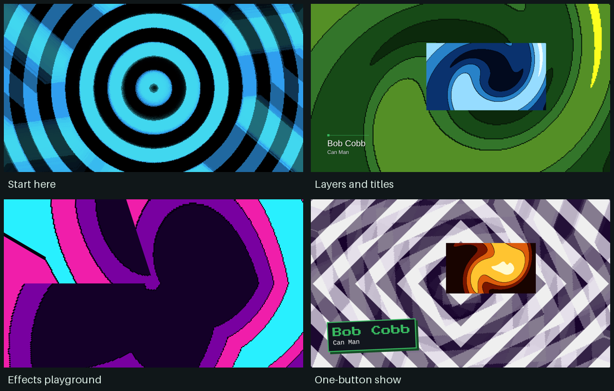

# Deckboy example shows

Five small shows that work up one step at a time, from a picture on a screen to
a whole show run from one button. For **Deckboy 0.99.417 or later**. Two clips
from *Tears of Steel* and the original music are in `media/`; every other
picture is made live by Deckboy.

## Start here

In Deckboy, **EXAMPLE SHOWS** on the startup screen copies these shows to your
Documents folder and opens the first one. From a download instead: extract the
ZIP first (right-click, **Extract All** on Windows), keep `media` beside the
shows, and **OPEN** `01-picture-on-screen.deckboy`. Deckboy saves as you go;
**SAVE AS** (`Ctrl+Shift+S`) first if you want to keep the original.

New to Deckboy? **LEARN THE BASICS** on the startup screen is a five-minute
guided tour of the same first steps.

1. **Turn the output on.** MENU → Video Outputs → **OUTPUT OFF**, so it reads
   **OUTPUT ON** (or **1 Output on** in DASH, `Ctrl+D`). The output window opens,
   black until you take a cue. For a projector or second screen, choose it on
   the same page first.
2. **Put a picture on it.** Click cue 01 and press **TAKE** (`Enter`). The
   output reads **YOUR OUTPUT IS LIVE**.
3. **Take the next cue.** Press **Page Down**: a clip, then a picture Deckboy
   draws itself, then the last card. **B** (BLACK) clears the screen at any
   time and brings it back.

Keep the `media` folder beside the shows when moving or sharing them. To save a
show elsewhere together with its media, use **BUNDLE**.

## The five shows

| Show | What it teaches |
|---|---|
| **01 — Picture on screen** | Output on, TAKE, the next cue, BLACK. Four cues. |
| **02 — Running a show** | A running order: a cue with its own 2-second crossfade, a clip that goes to black at its end (the others hold their last picture), one that loops until you move on, and one that fades out by itself. |
| **03 — Layers and titles** | Three playlists in one picture: backdrop, inset and a transparent Lower Third. Open DASH and try its five named scenes; switch the backdrop while the other layers stay on air. |
| **04 — Looks and effects** | One source, six looks: kaleidoscope, RGB split plus scanlines, an animated ripple, text mode and geometry motion. Switch an oscillator off to compare. |
| **05 — One-button show** | A 39-second sequence of picture, words, an inset and original music. Turn the output on, open DASH, press **Run sequence**. |

Every cue has a short note in the inspector, and each show's first cue says
what that show teaches. The layered shows also have named master-tracker rows:
choose **Open tracker** in DASH to see which cue each scene fires on each playlist.

## Explore the layers

In **Layers and titles**, try the scene buttons in order:

1. **All three layers** — live backdrop, inset and Bob Cobb / Can Man.
2. **Change the backdrop** — swap its palette while the layout stays in place.
3. **Change inset and Lower Third** — a kaleidoscope inset and an arcade Lower Third.
4. **Fireside interview** — a new background with the Lower Third.
5. **Clean backdrop** — the background alone.

The **Clear layer** cues are transparent. Taking one removes that playlist's
picture; taking its first cue brings it back. Inspect the inset's geometry to
change its size and position, or edit the Lower Third's title and subtitle.

## Run Soft Circuit

The automated show has six scenes:

| Time | Scene |
|---|---|
| 0–8 seconds | Doors: holding look, title and music |
| 8–16 seconds | Opening: new picture and title together |
| 16–24 seconds | Main scene: mirrored synth, lower third and inset |
| 24–28 seconds | Clear the inset |
| 28–36 seconds | Closing title and backdrop |
| 36–39 seconds | Picture fades to black; music fades out |

**Hold sequence** pauses the tracker's progression; the current sources keep
playing. **Run sequence** resumes from the current row. To run the whole show
again, press **Doors**, then **Run sequence**.

Try changing a scene's length in the tracker, replacing a title, or substituting
your own audio. The included music lasts 39 seconds, so adjust the soundtrack
too when changing the show's overall length.

## Make it yours

- Duplicate a cue before changing it to keep a reference.
- Change a Swirl palette, then compare the result with a different effect.
- Bypass the ripple's amount LFO to compare a moving effect with a fixed one.
- In text mode, change the number of columns and the glyph set.
- Use the same scene structure for a talk: holding slide, introduction, speaker,
  closing slide.

The shows and the original synthesized music are provided under GPL-3.0, like
Deckboy (see `LICENSE.txt`); the music uses no third-party samples.

The two clips in `media/` (`tears-of-steel-street.mp4`,
`tears-of-steel-workshop.mp4`) are 10-second excerpts of *Tears of Steel*,
(CC) Blender Foundation | mango.blender.org, licensed
[CC BY 3.0](https://creativecommons.org/licenses/by/3.0/). See `media/CREDITS.txt`.
