# Deckboy 🎬

<div align="center">

[](https://github.com/Utopian-Academy/Deckboy/releases/latest)
[](https://github.com/Utopian-Academy/Deckboy/releases)
[](https://github.com/Utopian-Academy/Deckboy/stargazers)
[](https://discord.gg/AZzsE4AZWx)

[](https://github.com/Utopian-Academy/Deckboy/releases/latest)
[](https://github.com/Utopian-Academy/Deckboy/actions/workflows/build.yml)
[](LICENSE)

[](https://libsdl.org)
[](https://github.com/florisporro/awesome-ndi)
[](https://github.com/RobLoach/awesome-sdl)
[](https://github.com/juancarlospaco/awesome-streaming-tools)

</div>

## Video playback and show control.

Deckboy puts videos, slides and live sources in a running order. Choose the next
cue on your desk and take it to the audience when you're ready. Send the programme
to screens, broadcast outputs or streams, and record it while it plays.

Free and open source, for Windows, macOS and Linux.

**[⬇ Download](https://github.com/Utopian-Academy/Deckboy/releases/latest)** &nbsp;·&nbsp; **[▶ See Deckboy 419 in action](https://utopian-academy.github.io/Deckboy/trailer.html)** &nbsp;·&nbsp; **[♡ Community & help](https://utopian-academy.github.io/Deckboy/community.html)**

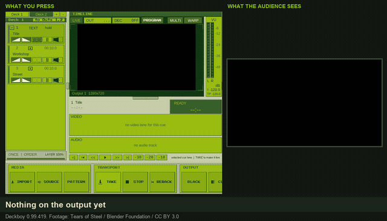

<sub>What you press, and what the audience sees, from one run of v0.99.419. [Watch Deckboy with music by YMCK](https://utopian-academy.github.io/Deckboy/trailer.html). Footage: [Tears of Steel](https://mango.blender.org/), Blender Foundation, [CC BY 3.0](https://creativecommons.org/licenses/by/3.0/).</sub>

**If Deckboy is useful to you, ⭐ star this repository** (top right): it is how the next
operator finds it, and how you find it again.

### New in 0.99.419

[Release notes and downloads](https://github.com/Utopian-Academy/Deckboy/releases/tag/v0.99.419)

- **Learn the basics.** A five-minute guided tour from the startup screen or MENU.
  Dr. Pixel and Professor Video take you through your first show one real control
  at a time, in a practice show that leaves yours alone.
- **Crossfades that keep moving.** Take the next cue and the one on screen keeps
  playing while it fades out, with its sound fading too.
- **Warp what you're looking at.** While you warp an output, the monitor shows that
  output, warped, with the corner handles on the picture.
- **Moiré.** A new source under SOURCE > MADE BY DECKBOY: six interference patterns,
  four palettes, and a `~` oscillator on every control.
- **Scopes that keep up.** Every new picture from the source is measured, and the
  footer tells you if anything is missed.
- **Smooth on 4K.** Swirl and Fireside hold 60 fps on 4K screens, and outputs stay
  at your screen's refresh rate.
- **Four example shows** on the startup screen, with notes on every cue: your first
  output, layers and titles, effects, and a one-button show.

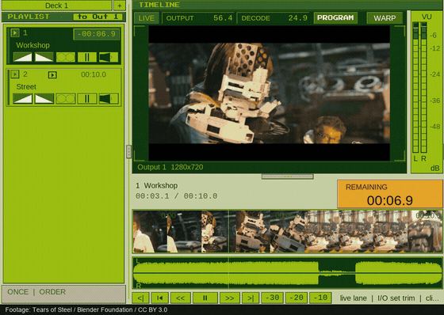

<sub>A real crossfade in v0.99.419: the outgoing clip keeps playing until it has faded. Footage: [Tears of Steel](https://mango.blender.org/), Blender Foundation, [CC BY 3.0](https://creativecommons.org/licenses/by/3.0/).</sub>

#### Also in recent releases

- **Master tracker:** a pattern view with keyboard editing, cue, fade, volume and opacity
  cells, column mute/solo, jumps and named sections. The classic grid is still there.
- **HDR:** graphics over PQ or HLG feeds, HDR window output, ST 2110, SRT/enhanced RTMP
  and recording.
- **Phone control:** pair with a QR code; TAKE, transport, fader, cue list, DASH and
  tracker on one page.
- **Lights and live audio:** named fixtures over Art-Net or sACN, Mic cues with fades and
  processing, and live captions made on your machine.
- **Projection:** edge blending, test cards and saved defaults for new shows.

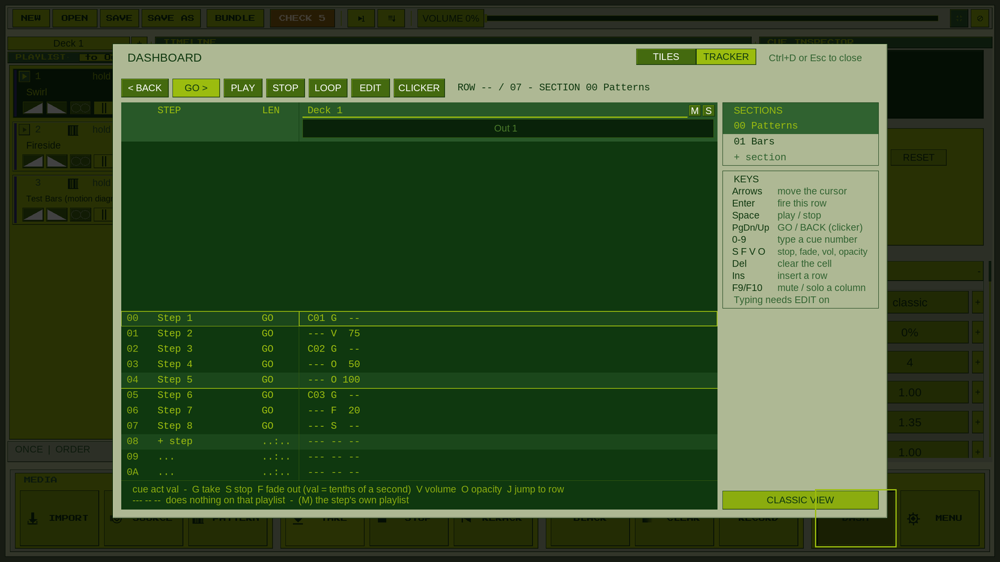

### A closer look

<table>
<tr>
<td width="50%"><b>Picture scopes</b><br>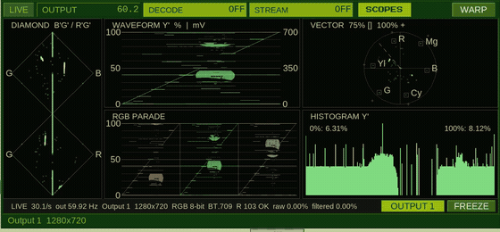<br>Waveform, vectorscope, parade and gamut measurements from the moving test card.</td>
<td width="50%"><b>Lights by name</b><br>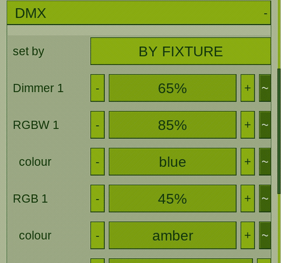<br>Fixture levels and colours in the cue list.</td>
</tr>
<tr>
<td width="50%"><b>Live input, cued</b><br>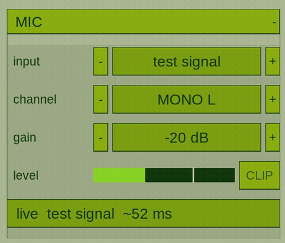<br>A Mic cue's gain and meter, shown with the built-in test signal.</td>
<td width="50%"><b>The phone controller</b><br><a href="https://utopian-academy.github.io/Deckboy/#phone-demo">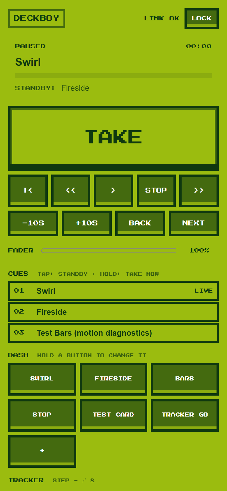</a><br><a href="https://utopian-academy.github.io/Deckboy/#phone-demo">Watch it select and take cues.</a></td>
</tr>
</table>

<details>
<summary><b>The current desk in three themes</b></summary>

**Gameboy**

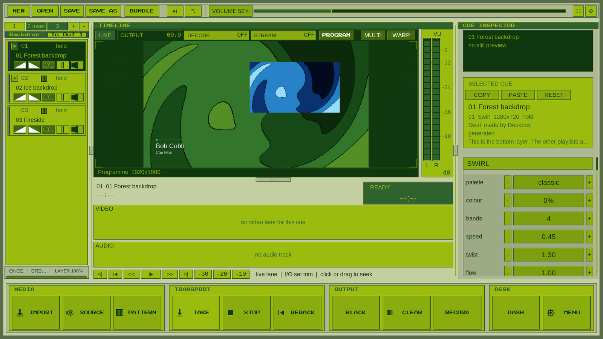

**Dark**

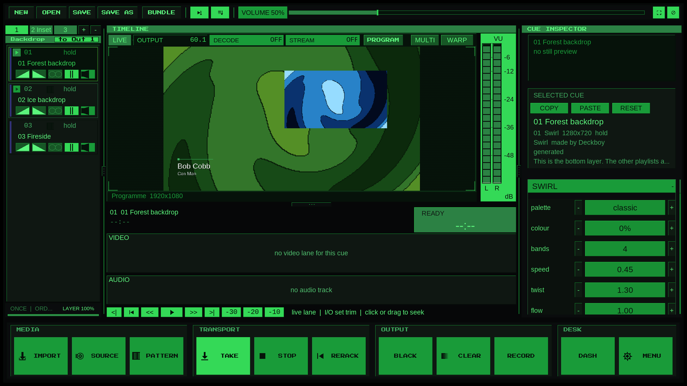

**Virtual Boy**

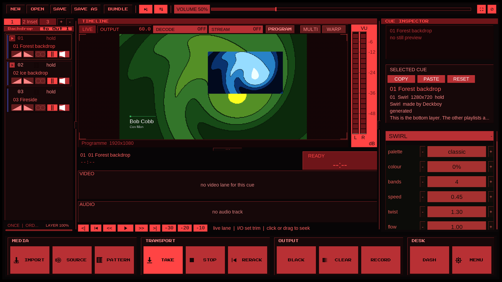

</details>

[All screenshots, GIFs and clips](https://utopian-academy.github.io/Deckboy/press.html#images)
are real app captures. Desk, crossfades, effects and scopes: published v0.99.419.
Other captures retain their original versions in the [media notes](../docs/images/readme/README.md).

New to Deckboy? Choose **EXAMPLE SHOWS** on the startup screen, read the notes on each
cue and make the show your own.

### Everything is a cue

A clip. A still. A slide. A live camera. A window on the machine. A web page.
An NDI source, an SRT feed, an SDI input. A test card, a countdown, a lower
third, an audio file, a line-up tone. A line of code you type while it is on
the screen. In Deckboy every one of those is the same kind of object, sitting
on the same cue list, and it behaves the same way: same transport, same fades,
same seventeen transitions, same effect rack, same remote control, recorded the
same way on the way out.

So a show can run

```
VIDEO → SLIDE → LIVE CAMERA → WEB PAGE → SRT FEED → TEST CARD → VIDEO
```

with one operator, one spacebar and no alt-tab, because none of those is a
special case. The usual way to do that is a media player, a slide program, a
browser, a capture utility, a streaming tool and a pattern generator, each with
its own idea of what happens when you press play — and a projector that shows
the seams between them.

The other half of the same idea: every **destination** is the same kind of
object too. A screen, NDI, SRT, RTMP, Blackmagic SDI, SMPTE ST 2110 — several
at once, while it records, each with its own warp, feather and area of
interest. Driven from a Stream Deck, Bitfocus Companion, OSC, MIDI, MIDI Show Control
from the lighting desk, Art-Net or LTC timecode.

Anything that can make a picture or a sound becomes a cue. Anything that needs
to receive the show becomes an output.

It hosts **your own VST3 effects and instruments** in a cue's audio chain, and runs on a
machine with **no sound card at all** — a rack PC feeding a video wall still
opens, plays and puts a picture out.

Windows, macOS and Linux from one show file. No account, no licence server, no
telemetry, and no second licence for the spare machine in the flight case —
which is not true of most of what it gets compared to.

**[deckboy website](https://utopian-academy.github.io/Deckboy/)** — what it does, and where to download it. · **[How it compares](https://utopian-academy.github.io/Deckboy/compare.html)** to Mitti, PlaybackPro, QLab, Millumin, vMix, SimplePlay, PlayDeck, ProVideoPlayer, Resolume and Inkue. · **[Manual](https://utopian-academy.github.io/Deckboy/manual.html)** — all of it, thirty chapters. · **[FAQ](https://utopian-academy.github.io/Deckboy/faq.html)** · **[Where latency hides](https://utopian-academy.github.io/Deckboy/latency.html)** — the four stages of a live chain, in frames and milliseconds

---

## Community & help

Questions, bugs, production stories, or ideas? [Visit the community page](https://utopian-academy.github.io/Deckboy/community.html) or [read the support guide](SUPPORT.md), join [GitHub Discussions](https://github.com/Utopian-Academy/Deckboy/discussions), or [contribute](CONTRIBUTING.md). For security issues, please use [private reporting](SECURITY.md), not public issues.

Deckboy is free software. If it helps you run a show, share your experience, report a bug, improve the docs, or tell another operator about it. That's how the project grows.

---

## Download

**[Try the example shows](../data/demos/starter-pack/README.md)** — five shows that
work up one step at a time: a picture on a screen, a running order, layers and
titles, looks and effects, and a 39-second show run from one button with original
music. Open the `.deckboy` files and follow the cue notes.

The features below describe the current source. Packaged builds and their
version-specific changes are listed on the [releases page](https://github.com/Utopian-Academy/Deckboy/releases).

Every release ships an installer **and** a portable build for each platform.
Both bundle the application, FFmpeg and its runtime libraries for ordinary file
playback. NDI uses the separately installed NDI runtime; SDI uses compatible
Blackmagic hardware and Desktop Video. Office slide conversion uses PowerPoint,
Keynote or LibreOffice on the machine. [Full requirements](https://utopian-academy.github.io/Deckboy/specs.html#system).

| Platform | Installer | Portable |
|---|---|---|
| **Windows** | `…-windows-x64-setup.exe` — Start Menu, uninstaller, `.deckboy` file association | `…-windows-x64.zip` |
| **macOS** (Apple Silicon) | `…-macos-arm64.dmg` — drag to Applications | `…-macos-arm64.zip` |
| **macOS** (Intel) | `…-macos-x86_64.dmg` | `…-macos-x86_64.zip` |
| **Linux** | `…-x86_64.AppImage` — one file, `chmod +x` and run; or `…-x86_64.flatpak` | `…-linux-x86_64.tar.gz` |

**Deckboy Mini** comes inside all of those, and on its own as a small download
of about 12 to 18 MB: `Deckboy-Mini-…-windows-x64.zip`, `…-macos-arm64.zip`,
`…-macos-x86_64.zip`, `…-linux-x86_64.tar.gz`, and `…-linux-arm64.tar.gz` for a
Raspberry Pi (64-bit) or any ARM64 Linux.

Both control surfaces ship with every release, so neither needs a build:
**Stream Deck** (`…streamDeckPlugin` — double-click it) and **Bitfocus
Companion** (`Deckboy-companion-module-….zip` — unzip it, then point
Companion's *developer modules path* at the folder containing it;
`INSTALL.txt` inside has the three steps). The Companion module requires
**Companion 5**.

→ **[Latest release](https://github.com/Utopian-Academy/Deckboy/releases/latest)**

Or from a package manager, which follows each new release:

```powershell
# Windows (Scoop)
scoop bucket add deckboy https://github.com/Utopian-Academy/scoop-deckboy
scoop install deckboy/deckboy
```

```sh
# macOS (Homebrew)
brew install --cask utopian-academy/deckboy/deckboy
```

<details>
<summary><b>"Unknown developer" warnings — what to do</b></summary>

Deckboy's Windows builds are unsigned and macOS builds are ad-hoc signed.
Neither carries a verified publisher signature, so the OS may warn when you
first open a download.

- **macOS** — if it says the app is damaged, clear the quarantine flag once:

      xattr -dr com.apple.quarantine /Applications/Deckboy.app

  Install from the `.dmg` into Applications rather than running from Downloads;
  that is also what avoids Gatekeeper's App Translocation sandbox.
- **Windows** — SmartScreen may say "Windows protected your PC". Click
  **More info → Run anyway**.
- **Linux** — the AppImage runs on **Ubuntu 22.04 and anything newer**, which
  is what a lot of venue machines are still on. Graphics, display server, audio
  and the C/C++ runtime deliberately come from the host: they have to match the
  machine actually running, and a bundled libGL cannot load your GPU driver.
  The build checks that floor on every run rather than trusting it.

</details>

Deckboy checks interface labels at startup and automatically tries another
rendering path when needed. The [FAQ](https://utopian-academy.github.io/Deckboy/faq.html#interface-text)
explains the renderer log and how to select software rendering on a Mac.

---

## What it is

Deckboy is a native desktop application for video engineers, AV technicians and
live operators who need a reliable way to organise media, trigger cues, loop
content and send video to production displays.

That is the job it is built around, and it is built on a stubborn principle:
**Seize the means of playback ♡**

No subscription ♡ No account ♡ No telemetry ♡ Nothing phones home. And no licence
server that can refuse to start the show at 19:55 because it could not reach the
internet. The machine you carried into the venue is the machine that plays the
show.

### What can be a cue

| | |
|---|---|
| **Video** &middot; **Image** &middot; **Audio** | files, hardware-decoded, trimmed and faded |
| **Slides** | a PDF, PowerPoint or Keynote deck, one cue per slide, with the notes |
| **Browser** | a URL rendered into the programme, not a browser window on your desktop |
| **Window** &middot; **Screen** &middot; **Camera** | captured live, at the window's own full resolution |
| **NDI** &middot; **SRT / RTMP / RTSP / UDP** &middot; **DeckLink** &middot; **Spout** | somebody else's signal, taken in as a cue |
| **Pattern** &middot; **Test card** &middot; **Tone** | generated on the spot, no file needed |
| **Timer** &middot; **Lower third** | a stage countdown, full screen or over the programme, and a name strap in 52 looks |
| **Video synth** &middot; **Code** | an oscillator with feedback, or an expression you type live |

Every row takes the same fades, the same transitions, the same effect rack, the
same trigger from a Stream Deck, and is recorded the same way on the way out.
[Chapter 5 of the manual](https://utopian-academy.github.io/Deckboy/manual.html#cue-types)
is the full table, source by source.

### Which makes it a very good video Swiss army knife

That is not a second feature list. It is what falls out of the first one. If a
camera is a cue and SDI is an output, the machine is a converter. If a stream
is a cue and NDI is an output, it is a bridge. If a test card is a cue, it is a
pattern generator that proves the real chain instead of a test box's.

The same box speaks NDI, SDI, SMPTE ST 2110, SRT, RTMP, Spout, LTC timecode,
OSC, Art-Net and NMOS — so the machine you brought for playout usually solves
the other five problems on the day as well.

- **Convert media** that will not play well, in place, without leaving the app
- **Inspect any file** — codec, raster, frame rate, channels, duration — by importing it
- **Generate test patterns** and a test card to prove a chain end to end
- **Capture** a camera, a window or a screen and treat it as a cue
- **Bridge formats** — bring a camera, capture card or stream in and send the
  programme out as SDI, ST 2110 or a stream, and record it
- **Normalize loudness** to a chosen −16, −23 or −24 LUFS target before playout
- **Generate LTC timecode** on its own routable output

### Where it gets used

Live events • Corporate presentations • Churches • Schools & universities •
Museums & installations • Digital signage • Projection • LED walls • Streaming

And the jobs in between: bench-testing a screen before anyone arrives, proving a
cable or converter with a real test card, getting a camera or a stream onto
SDI, restreaming to SRT or RTMP, or making a client's unplayable file
playable on site, minutes before doors.

### Deckboy Mini

For a screen that only needs to play. `deckboy-mini` ships beside Deckboy: point
it at clips or a folder and it plays them fullscreen through the same engine as
the desk, in name order, holding stills, looping if you ask. It answers the
desk's remote commands on the desk's port, so Companion drives it as deck 1,
and the whole show runs from the keyboard in its terminal, over SSH too:
reorder, rename and remove cues, save and open playlists (M3U8), pick the
display and the sound device, and the keys a media player has — frame step,
speed, A-B loop, mute, sound track and subtitles. It keeps a media player's
running-order habits too: find a cue by name, queue the one to play next, stop
after this cue, shuffle, a clock that counts down, and a crossfade between
cues. It opens `.pls` lists as well as M3U8. On a Raspberry Pi it plays
through the board's own video decoder; `tools/linux_build.sh --mini` builds it
there. Its own [miniature manual](https://utopian-academy.github.io/Deckboy/manual.html#deckboy-mini)
has every key and command. Mini comes inside every download, and on its own as
a small download for Windows, macOS, Linux and the Raspberry Pi (64-bit) on the
[releases page](https://github.com/Utopian-Academy/Deckboy/releases/latest).

```
deckboy-mini ~/Videos --display 2 --loop
```

In Windows PowerShell, start it as `.\deckboy-mini` from its folder; PowerShell does not
run a program from the current folder by its bare name. Or drop files onto `deckboy-mini.exe`.


---

## Features

The long version. It is long because the cue list absorbs so much — but it is
all one object with one set of controls, not fifty separate things to learn.

<details>
<summary><b>Playback &amp; cues</b></summary>

- Cue-based video playback with playlist management
- Drag-and-drop media import
- Play, pause, stop and seek; CLEAR immediately stops every deck, cancels queued
  takes, drops held pictures and overlays, and disarms output
- Looping and hold-last-frame behaviour
- **Captions made on this computer**: a clip with none gets them from its own
  sound, written beside it as a subtitle file and switched on, with nothing
  leaving the machine. English or any language; the speech engine comes with
  Deckboy on all three platforms
- Memo cues (a note in the running order) and devamp (a looping cue finishes
  its pass, then ends)
- Fade in/out, per cue and per deck
- Cue trimming, and per-cue transition overrides
- Seventeen transitions: cut, crossfade, dip to black or white, four pushes,
  four wipes, an iris and four procedural styles — set per deck, overridden
  per cue, timed in seconds, keeping each cue's fit, crop, geometry and look
- Compact cue rows and a full-width focused deck with tabs when several
  comfortable columns cannot fit
- Keying, grading and picture effects apply immediately to a playing or paused
  cue, without another TAKE

</details>

<details>
<summary><b>Sources — everything that can be a cue</b></summary>

- Video clips, images and audio files
- **Slide decks** — a PDF, PowerPoint or Keynote deck imports as one image cue
  per page, rendered at import by the platform's own engine, so nothing during
  a show depends on a document renderer
- Browser cues, rendered inside the programme rather than by a browser
  window on your desktop — a scoreboard, a dashboard or a lyric page is a
  cue like any other, with the same fades and effects
- Camera, window and screen capture, on all three platforms. A window cue
  arrives at the window's own full resolution whatever your display scaling
  is set to, scaled to fit the frame, follows the window as it moves and
  resizes, and anything in front of it stays out of shot. It runs at sixty
  frames a second where the window can afford it, and costs about a fifth of
  what it did: on a 960x540 window with a 4K output, processor use across the
  capture and the application fell from roughly 225% of a core to 45%
- Stream cues take `srt://`, `rtmp://`, `rtsp://`, `udp://` and http HLS
- NDI receive in every download, and Blackmagic DeckLink capture through the
  SDK rather than through a pipe
- Spout shared textures from another application on the machine (Windows)
- **IPTV channel lists**: import an `.m3u` and every channel becomes a cue,
  named and grouped from the list
- Test patterns, a built-in test card, and generated line-up tone
- **Swirl**, a generated pixel spiral with palettes, colour bands, speed (forward
  or reverse), twist, flow, zoom, a movable centre and density, all live, saved
  with the cue and available over the control protocol
- Timer cues — a stage or speaker countdown with its own clock, thresholds and
  chimes. Its backdrop can go transparent and it has its own size and position,
  so the clock can sit over the programme instead of replacing it
- Lower thirds, cued like anything else, in 52 looks: branded straps, paper
  cards, cloth banners, phosphor terminals, split-flap cells and **arcade**.
  Themed looks bring their own materials and entrances; cassette reels turn,
  marquee bulbs chase and Equalizer follows the programme's sound. Any look
  can use Arcade's slow bob and tilt with Wiggle. Colours, size and Wiggle
  can be set from a Companion button
- Picture in picture, side by side or a quad: lay a second playlist over the
  first as a layer and scale and place it, with a whole playlist behind each
  window instead of one fixed box

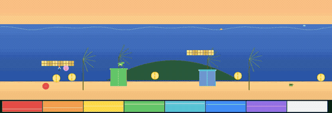

- A **video synth** — oscillators with feedback, a glitch stack, text mode and
  sprite sets, among them the pickle set by Garrick Folderouy — and a **code source**, a live-coded expression evaluated per
  pixel and edited while it runs. Its own render width and height set the work
  it does independently of its placement on the output; an incomplete edit
  holds the last good picture

</details>

<details>
<summary><b>Outputs — everywhere a cue can go</b></summary>

- Fullscreen output windows, display selection, and the same programme on more
  than one output at once
- Display-native and fixed raster modes
- Area of interest, warp / keystone correction, gamma-correct edge blending,
  paired overlap, projector gamma and black lift
- **Projection mapping per layer**: drag a layer's four corners onto a surface
  on the programme monitor, in **perspective**, so a flat board stays flat with
  its far end properly smaller, or linear. The programme, the recording and the
  stream all carry it

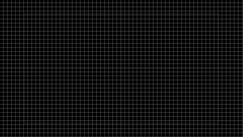

- Per-output matte and still overlay, composited into the output's own picture
- NDI output, in every download
- DeckLink (SDI) output, wherever the Blackmagic SDK is present, with scheduled
  video and audio, limited-range BT.709 conversion and eight- or ten-bit packing
- SRT and RTMP streaming, each output with its own destination, running while
  the programme is recorded
- Recording that keeps its sound, continuous for the whole take
- Web Monitor shows programme -- or the multiview, a presenter view, any
  output -- with stereo sound in any browser. Screens watching together stay
  in step, a low-latency mode sends the picture alone, and a QR code opens it on
  a phone
- Picture and sound stay in sync through a long show, following the sound
  card's own clock
- Eight- and ten-bit BT.709 SDR video retains its source range on programme
  output. HDR10 and HLG are converted automatically for SDR outputs
- Floating-point HDR window outputs, with SDR graphics at 203 nits by default;
  PQ or HLG recording, SRT/enhanced RTMP and ST 2110 output. See the
  [HDR specifications](https://utopian-academy.github.io/Deckboy/specs.html#hdr)
  for platform, encoder and receiver requirements
- A test card per output, drawn at its own raster, with moving checks, safe
  areas, frame counter and export to H.264 movies
- Programme picture scopes: waveform, parade, vectorscope, histogram and gamut
  checks, including HDR measurements in nits and the SDI/ST 2110 4:2:2 signal

</details>

<details>
<summary><b>Presenting from slides</b></summary>

- Import a PDF, PowerPoint or Keynote deck as one cue per slide, rendered once
  at import by the platform's own engine -- nothing during the show depends on
  a document renderer
- A cat accompanies slide rendering, with measured page progress as the
  slides arrive; timeline loading keeps its filmstrip and audio-meter displays
- Speaker notes come with the deck, so a team working a master deck elsewhere
  keeps its fonts *and* its notes
- **Presenter view** as an output type, so it takes its own display: the live
  slide, the one before it, the one after it, the notes and the clock. Every
  panel switches off on its own, the colours are yours, and the panels are
  dragged into place rather than chosen from a list of layouts
- The clicker walks long notes a part at a time, at the speaker's pace — and
  Page Down and Page Up just work, because that is what every clicker sends

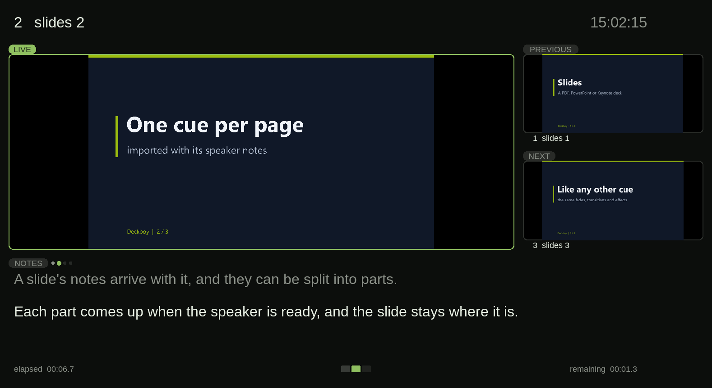

- **Teleprompter view**, also an output of its own: the script large, scrolling
  through a fixed reading line, mirrored for a beamsplitter, and driven from a
  hand controller over the control protocol

</details>

<details>
<summary><b>Broadcast / IP video</b></summary>

- SMPTE ST 2110-20 uncompressed video output
- SMPTE ST 2110-30 (AES67) audio output
- PTP (IEEE 1588 / SMPTE ST 2059) media clock slaving
- AMWA NMOS IS-04 registration and Node API
- AMWA NMOS IS-05 connection management, so a broadcast controller can
  discover and route Deckboy's senders
- MediaMTX both ways: its streams appear as one-click stream cues, and the
  programme publishes to it for any number of viewers

Video and 48 kHz stereo audio have independent sender controls for activation,
source and destination addresses, ports and interface binding. PTP acquisition
and reacquisition update the media clock. See
[docs/ST2110_FEASIBILITY.md](../docs/ST2110_FEASIBILITY.md).

</details>

<details>
<summary><b>Audio</b></summary>

- Per-cue gain trim, pan and mono fold-down
- Loudness normalization with selectable −16, −23 (EBU R128) and −24 LUFS targets
- Programme metering with momentary, short-term and integrated LUFS, true peak,
  and a true-peak guard on the mixed output
- Independent audio fades, separate from video fades
- Content-authoritative stereo waveform display
- Audio-only cues, and per-cue mute
- A file with more than one sound track (a second language, a commentary)
  lets you choose which one plays, even on the cue that is on air
- Up to 128 output channels per deck, with a crosspoint matrix routing each cue
  onto any of them: enough for a full Dante or MADI rig
- **Your own VST3 effects and instruments, in the cue's chain.** The reverb you
  already own or the channel strip your mix is built around, sitting beside
  Deckboy's own effects in whatever order you put them, with its settings saved
  in the show. Instruments play from a MIDI keyboard, a controller over the
  network, or the computer's own keys
- **A per-cue effect chain** -- high pass, low pass, tilt EQ, compressor, gate,
  delay, reverb, width and binaural placement, in the order you put them in
- **Five effects that use what the deck knows**, which no plugin is ever told:
  the cue's own picture driving a filter, its position on the output becoming
  the sound's position in the room, the end of the cue resolving the tail,
  stutter locked to the video frame, and a held cue keeping its room tone
- **Eight bends**, for when the point is damage rather than polish — bit
  crushing, a CD skipping, corrupted filter coefficients, and *ouroboros*,
  where the finished picture drives the bend that is driving the picture

</details>

<details>
<summary><b>Show control</b></summary>

- Bitfocus Companion integration (module included)
- OSC input and OSC Query
- TCP command control — every verb answers `OK` or `ERR`
- **Triggers on every cue**: a hotkey, a MIDI note, an OSC address, a time of
  day or a timecode point fires it through the same take as GO
- **CHECK**: everything wrong with the show in one list (missing media, a
  device that is not connected, a plugin that is not installed); pick a line to
  go straight to it
- HyperDeck protocol emulation, so a deck controller can drive it
- Tally-driven playback: roll when an ATEM or an NDI receiver puts you on air
- LTC timecode in, and an LTC generator routable to its own device and channel
- MIDI input, Art-Net / sACN DMX, NMC transport sync in and out
- Phone and tablet control, paired by QR or passphrase: TAKE, transport, fader,
  cue list, editable DASH, tracker and show controls on one page
- Master tracker in pattern or classic view, with keyboard editing, stop/fade/
  volume/opacity cells, column mute/solo, jumps and named sections
- A fixture patch: lights named once, set by name and colour with LFOs, and dipped
  automatically while a video rolls
- Mic cues: a live microphone or line input as a cue, with its own fades, effects and routing

</details>

<details>
<summary><b>Effects &amp; mixing</b></summary>

- A per-cue effect stack on every kind of cue, ordered, with copy/paste of a
  whole chain between cues
- **Levels and curves** first in the list: black and white point, midtones and
  lift; an S-curve per channel with shadow lift and highlight roll-off. Both
  arrive neutral and cost under a millisecond a frame at 1080p
- Effects go on and off a live cue without interrupting it

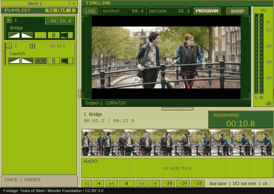

- Forty-two effects, each with named parameters. `--effect-bench` measures
  the cost on your machine; resolution and the chosen stack determine the frame budget
- Six that exist nowhere else: schlieren gradient imaging, Chladni nodal
  figures, a true wave equation with inertia, crystal grain growth, retinal
  rod/cone persistence, and structure tensor grain flow
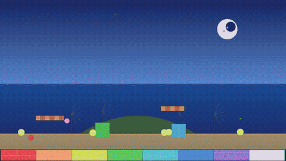

- **Two that cross between picture and sound.** *Databend* reads the frame out
  as a signal and plays it through an audio chain — a delay with feedback, a
  filter, a wavefolder — then paints what comes back, which is the look people
  chase by opening a picture in an audio editor, on a live cue and on a knob.
  *Audioprint* goes the other way and draws the audio the deck has just played
  through the picture, a slice of sound per row. Put one of each on the same
  cue and they bend each other
- An LFO on any parameter — six shapes, free running or locked to a tap tempo
- VJ mode: a second deck live, a crossfader with ten blend modes — dissolve,
  add, screen, multiply, lighten, darken, subtract, undercut, infiltrate and
  ember — tap tempo, and takes quantised to the beat

</details>

<details>
<summary><b>Interface</b></summary>

- **Thirty bundled themes**, switchable live and from a controller, including
  high-contrast terminal themes suited to OLED panels
- Timeline with filmstrip thumbnails; resizable program monitor and timeline
- UI scale that follows the desktop's own scaling
- Save the current setup as your defaults for new shows: outputs, routing,
  decks, DASH, fixtures, theme and settings, without the cues
- A language picker with 43 languages, including Arabic and Persian right to
  left, Kurdish, Kabyle and Tamazight, Cubano, Klingon and a few written in
  cypher
- Every script on any desk: a cue named in Japanese, Chinese, Hindi or Arabic
  reads on an English desk, from the fonts the computer already has
- Missing-media detection with folder relink, so a moved drive does not cost you
  a rebuild

</details>

---

## Built for operators, not data harvesters

Deckboy collects nothing and sends nothing to its developers. **No telemetry,
no usage reporting, no crash upload, no account.** Crash logs are written to a
file next to the app for you to read or forward, and they stay there.

There is an update check, and it is **off by default**. Switched on, it asks
GitHub's releases API whether a newer version exists — nothing about you goes
with the question, and finding one never installs anything without you saying
so. A machine sitting on a venue's network should do nothing nobody asked it
to.

It is deliberately network-active — NDI discovery, PTP, NMOS registration, OSC,
Companion control and streaming all talk to the network by design. Every one of
those goes to your own LAN or to a destination you configured.

---

## Platforms

One show file opens on Windows, macOS and Linux, and nearly everything above
runs on all three. The exception: texture sharing with Resolume, TouchDesigner
or OBS is Spout, on Windows only.

Hardware decode is used wherever the platform provides it — D3D11VA, Video
Toolbox, VAAPI — and on Windows and macOS the picture never touches system
memory on the way to the screen: roughly ten times less CPU for 4K, which is
CPU your machine gets to spend on everything else.

---

## Documentation

- [Code map](../docs/CODEMAP.md) — file inventory, data flow, threading model
- [Packaging guide](../docs/PACKAGING.md)
- [Changelog](CHANGES.md)
- [ST 2110 feasibility](../docs/ST2110_FEASIBILITY.md)

The changelog is the authoritative record of what landed and, just as
importantly, what each feature deliberately does not do.

---

## Friends of Deckboy

- [AV Tools Pro](https://avtoolspro.com/) — free AV design calculators:
  projector throw and brightness, AVoIP and Dante/AES67 bandwidth, video wall
  and LED pixel pitch, cable, rack and PoE planning

---

## Roadmap

**Audio, next:**

- Multichannel audio files, up to 24 channels each, every channel routable
- Effects on a device's outputs as well as on each cue
- Fades that ramp effect settings and playback speed, not only level
- Object audio: place a cue in your speaker layout and move it across the room
- Named outputs and an output patch editor

**Show control:**

- Cue carts, and templates for new shows
- Defaults that say what they do: forgetting your saved defaults (which only
  changes what NEW starts from) told apart plainly from the show that is open
- A routing map: tap a deck's "to Out 1" tag to see where every deck, layer
  and output goes
- A lighting dashboard, beyond the fixture patch
- MIDI and OSC monitors: every message arriving, as it arrives, with what
  Deckboy did with it, so a controller that "does nothing" can be seen
- Live scoreboard data as a source: the clock, scores and fouls read off a
  venue's scoreboard by [OSO (Open Scoreboard OCR)](https://github.com/openscoreboardocr/OSO-Open-Scoreboard-OCR)
  and its XML/JSON feed, driving text and lower thirds on the outputs

**The face:**

- A face you can make your own: how it looks, what it does and what it talks
  about, including lines you write yourself. Every setting starts from the face
  as it is today, and none of them can touch playback, routing or outputs

**Picture:**

- Lip sync held within a few milliseconds across a whole day of playback, on
  every platform
- HDR the rest of the way: HDR over SDI shown on a real DeckLink card (it is
  built, not yet tested on one), HDR in over SDI, HDR over NDI (which needs
  NDI's separately licensed Advanced SDK), and HDR input on macOS and Linux
- Local AI upscaling: an upscale job that turns a clip into a sharper, bigger
  file, and real-time upscaling on the GPU where the hardware offers it
- Drawing on the picture: a pen that draws over the output live, the way a
  sports telestrator does, and paint cues drawn ahead of time that take, fade
  and layer like any other cue

**Scopes:**

- False colour on the picture scopes
- Sound scopes: loudness to EBU R 128, true peak, phase and spectrum
- Scopes on the desk, on any output and over NDI

**Deckboy Mini:**

- A media browser in the terminal: browse folders, filter by typing and add clips
  without leaving the keyboard, shared with the desk's own browser

**Web Monitor and network:**

- A Web Monitor at full resolution and the right shape, that pauses, rewinds
  and returns to live without losing the picture
- Encrypted connections (HTTPS) for the Web Monitor and the phone remote

**Platform:**

- Hardware-paced ST 2110 output for narrow-model compliance
- Syphon *input* on macOS as a cue source (Spout already works both ways on Windows)

---

## License

Deckboy is free software under the **GNU General Public License v3.0 or later**.
Copyright © 2026 Deckboy Contributors. The full text is in [LICENSE](LICENSE).

Bundled components keep their own licences — ffmpeg ships with its LGPL/GPL
notice beside the binary, and the NDI and DeckLink SDKs are loaded at runtime
rather than distributed.

NDI® is a registered trademark of Vizrt NDI AB.

---

## Contributing

Deckboy is built in the open and contributions are welcome — code, bug reports,
documentation, testing, or production feedback from a real show.

The best open-source tools are built by the communities that use them.

---

## Project status

Actively developed, on all three platforms. Windows, macOS and Linux build from
the same source and every commit is checked by CI in both full and
reduced-feature configurations — macOS as a self-contained app bundle, Linux as
a portable tarball and an AppImage.
